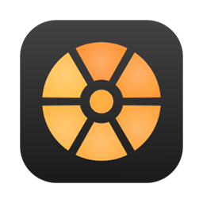
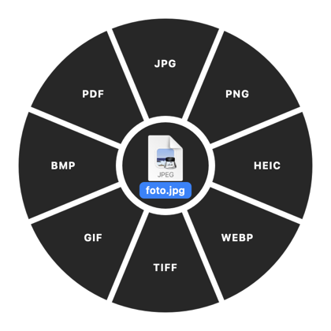
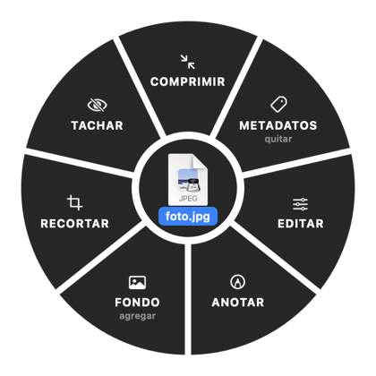
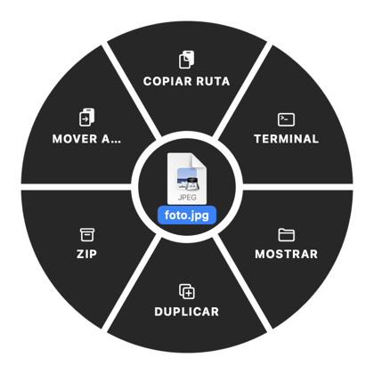
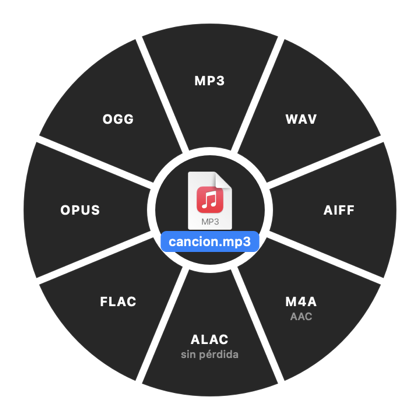
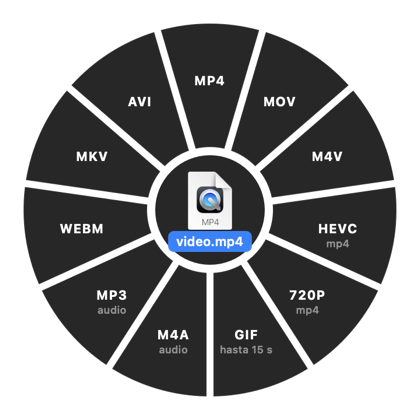
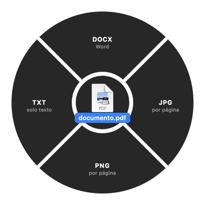
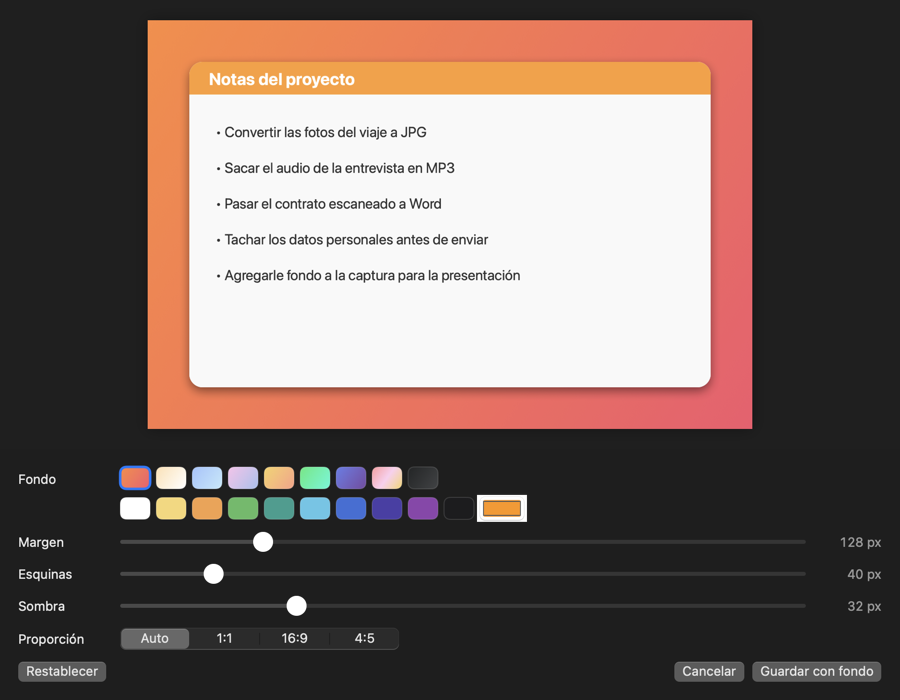

<p align="center">
  
</p>

<h1 align="center">Gajos</h1>

<p align="center">
  Convertí y editá archivos en tu Mac con solo arrastrarlos y tocar una tecla.<br>
  Imágenes, audio, video y PDF. Todo local, sin subir nada a internet.
</p>

<p align="center">
  <a href="https://github.com/MarceMelgar/gajos/releases/latest"><b>⬇️ Descargar Gajos 1.4 (.dmg)</b></a>
</p>

---

## Inspirado en Tangerine 🍊

Gajos existe gracias a **[Tangerine](https://x.com/th2049)**, la app de **Thameem** ([@th2049](https://x.com/th2049)).
La idea de arrastrar un archivo, tocar una tecla y elegir qué hacer en una rueda de gajos es suya.
Si te gusta este flujo de trabajo, andá a ver y apoyá su trabajo.

Gajos es un proyecto **independiente y sin relación con Tangerine ni con Thameem**: se escribió desde cero,
mirando solo cómo funciona la app por fuera (videos y capturas públicas). No contiene código, íconos ni diseños de Tangerine.

---

## Cómo funciona

1. Empezá a arrastrar uno o varios archivos (desde el Finder, el Escritorio, etc.).
2. **Sin soltarlos**, tocá una tecla:

   | Tecla | Rueda |
   |---|---|
   | ⇧ **Shift** | **Conversión**: cambia de formato |
   | ⌘ **Command** | **Herramientas**: comprimir, recortar, editar… |
   | ⌃ **Control** | **Acciones**: copiar ruta, Terminal, ZIP… |

3. La rueda queda abierta aunque sueltes la tecla. Soltá el archivo sobre un gajo.
4. El resultado se guarda **al lado del original**, con otro nombre. El original nunca se modifica.

La rueda se adapta al tipo de archivo: una imagen, un audio, un video o un PDF muestran opciones distintas.

<p align="center">
  
  
  
</p>

---

## Qué puede hacer

### Conversión (⇧ Shift)

| Tipo | Formatos |
|---|---|
| **Imagen** | JPG, PNG, HEIC, TIFF, GIF, BMP, PDF, WEBP* |
| **Audio** | WAV, AIFF, M4A (AAC), ALAC, FLAC, MP3*, OPUS*, OGG* |
| **Video** | MP4, MOV, M4V, HEVC, 720p, GIF animado, audio en M4A, audio en MP3*, WEBM*, MKV*, AVI* |
| **PDF** | DOCX (Word), TXT, JPG y PNG (una imagen por página) |

<sub>* Requieren los [formatos extra](#formatos-extra-opcional).</sub>

- Los PDF **escaneados** también se pueden pasar a texto o Word: Gajos reconoce el texto de la imagen (conviene revisarlo).
- Extraer audio de un video guarda la pista completa.

<p align="center">
  
  
  
</p>

### Herramientas (⌘ Command)

**Imágenes**

| Herramienta | Qué hace |
|---|---|
| **Comprimir** | Achica la imagen (máximo 2560 px) y baja el peso. |
| **Metadatos** | Quita ubicación GPS, cámara, fecha y otros datos ocultos, sin perder calidad. |
| **Editar** | Brillo, contraste, saturación, exposición, nitidez, girar y voltear. |
| **Anotar** | Flechas, rectángulos, círculos, lápiz y texto, en varios colores. |
| **Fondo** | Pone la imagen sobre un degradado o color, con margen, esquinas redondeadas, sombra y proporción (Auto, 1:1, 16:9, 4:5). Ideal para capturas de pantalla. |
| **Recortar** | Elegís el área con el mouse, libre o con proporción fija. |
| **Tachar** | Tapa zonas en negro, pixeladas o desenfocadas (para datos personales). |

<p align="center">
  
</p>

**Audio y video:** comprimir, recortar (con la barra de recorte de QuickTime), quitar metadatos y, en video, **agregar fondo** igual que en las imágenes (manteniendo el audio).

**PDF:** comprimir, recortar (primera página como imagen) y quitar metadatos (autor, título, etc.).

### Acciones (⌃ Control)

Copiar ruta · Abrir en Terminal · Mostrar en Finder · Duplicar · Comprimir en ZIP · Mover a… · y hasta 3 **carpetas favoritas** donde copiar con un solo gesto.

---

### Próxima versión (en desarrollo, todavía no está en el .dmg 1.4)

- **Comprimir a medida:** elegir por **calidad** (10 % a 100 %) o por **tamaño final** ("que pese 2 MB"), en imágenes, audio, video y PDF.
- **Fondo con imagen propia:** usar cualquier imagen de la Mac como fondo, con desenfoque opcional (en imágenes y videos).
- **GIF de un tramo:** elegir con la barra de recorte qué parte del video (hasta 15 s) se convierte en GIF.
- **MKV y WEBM** en Recortar, Comprimir y Fondo (con los formatos extra instalados).

---

## Instalación

**Requisitos:** macOS 13 (Ventura) o más nuevo. Funciona en Macs con Apple Silicon (M1, M2…) e Intel.

1. Descargá **`Gajos-1.4.dmg`** desde [Releases](https://github.com/MarceMelgar/gajos/releases/latest).
2. Abrilo y arrastrá **Gajos** a la carpeta **Aplicaciones**.
3. Abrí Gajos. Aparece un ícono redondo en la barra de menú (arriba a la derecha).

### La primera vez macOS la va a bloquear

Gajos no está firmada con una cuenta paga de desarrollador de Apple, así que macOS muestra un aviso la primera vez. Para abrirla igual:

- **macOS 15 (Sequoia) o más nuevo:** abrí Gajos → en el aviso tocá **Listo** → andá a **Configuración del Sistema → Privacidad y seguridad** → abajo de todo tocá **Abrir igualmente** → confirmá con tu contraseña o Touch ID.
- **macOS 13 o 14:** clic derecho (o Control + clic) sobre Gajos en Aplicaciones → **Abrir** → **Abrir**.

Se hace una sola vez.

### Abrir al iniciar sesión

Ícono de Gajos en la barra de menú → **Configuración…** → General → **Abrir al iniciar sesión**.

### Formatos extra (opcional)

macOS no trae codificadores para MP3, OPUS, OGG, WEBM, MKV, AVI ni WEBP. Para habilitarlos, Gajos usa [ffmpeg](https://ffmpeg.org) y [webp](https://developers.google.com/speed/webp) si están instalados:

- **Fácil:** dentro del `.dmg` hay un archivo **`Instalar formatos extra.command`**. Abrilo con doble clic (la primera vez: clic derecho → Abrir) e instala todo lo necesario.
- **A mano**, si ya usás [Homebrew](https://brew.sh):

  ```bash
  brew install ffmpeg webp
  ```

No hace falta reiniciar Gajos: los gajos correspondientes se activan solos.

---

## Configuración

Desde el ícono de la barra de menú → **Configuración…** podés cambiar:

- La tecla de cada rueda.
- El estilo de la rueda: **vidrio** o **sólido**.
- Sonido y vibración.
- La calidad de JPG, HEIC y WEBP.
- La app de terminal (Terminal, iTerm, Ghostty, Warp…).
- Las carpetas favoritas de la rueda de acciones.

---

## Privacidad

Todo se procesa **en tu Mac**. Gajos no tiene conexión a internet, no tiene cuentas, no envía datos ni estadísticas.
No necesita permisos de accesibilidad ni de grabación de pantalla.

---

## Compilar desde el código

Necesitás las herramientas de línea de comandos de Xcode (`xcode-select --install`). No hace falta Xcode completo.

```bash
git clone https://github.com/MarceMelgar/gajos.git
cd gajos
./build.sh          # arma build/Gajos.app para tu Mac
./make-dmg.sh       # arma dist/Gajos-<versión>.dmg universal (Apple Silicon + Intel)
```

Está hecho en Swift con AppKit y SwiftUI. Las conversiones usan lo que trae macOS (ImageIO, AVFoundation, PDFKit, Vision, `afconvert`) y, de forma opcional, `ffmpeg` y `cwebp`.

| Archivo | Qué contiene |
|---|---|
| `DragWatcher.swift` | Detecta el arrastre de archivos y el toque de las teclas. |
| `WheelView.swift`, `WheelController.swift`, `Wheels.swift` | La rueda y qué gajos muestra según el archivo. |
| `ImageConverter.swift`, `AudioConverter.swift`, `VideoConverter.swift`, `PDFConverter.swift` | Conversiones. |
| `ImageTools.swift`, `MediaTools.swift`, `VideoBackground.swift` | Comprimir, metadatos, recortar y fondo. |
| `BackgroundTool.swift`, `RedactTool.swift`, `EditTool.swift`, `AnnotateTool.swift`, `CropWindow.swift`, `TrimWindow.swift` | Ventanas de edición. |

---

## Limitaciones conocidas

- Al pasar un PDF a Word se conserva el texto y su formato, pero no las imágenes ni la diagramación exacta.
- El texto reconocido en PDF escaneados puede tener errores.
- En **Tachar**, el pixelado y el desenfoque a veces se pueden revertir: para datos sensibles usá **Negro**.
- Las canciones viejas de iTunes con DRM (`.m4p`) no se pueden convertir.
- Agregar fondo a un video recodifica el video entero, así que los videos largos tardan.

---

## Créditos

- **Idea original:** [Tangerine](https://x.com/th2049), de **Thameem** ([@th2049](https://x.com/th2049)). Gracias por la inspiración. 🍊
- **Gajos:** [@MarceMelgar](https://github.com/MarceMelgar).
- Formatos extra gracias a [FFmpeg](https://ffmpeg.org) y [libwebp](https://developers.google.com/speed/webp) (se instalan aparte; no vienen incluidos).

## Licencia

[MIT](LICENSE).
